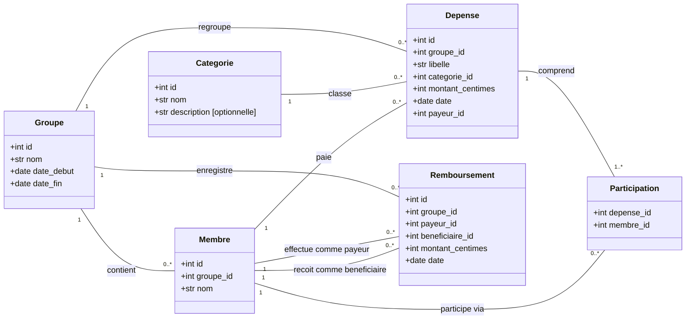

# Diagramme de classes — Partage de frais

Le projet ne définit pas de classes Python : `app.py` contient des fonctions Flask et `base.py` ouvre la connexion SQLite. Ce diagramme UML représente les entités métier d'après `base.sql` et les règles appliquées dans `app.py`.

## Lecture et correspondance avec le code

- Chaque entité correspond à une table ; `Participation` correspond à la table `participants`. Sa clé primaire est le couple `(depense_id, membre_id)`, qui interdit de participer deux fois à une même dépense.
- `1` signifie exactement un, `0..*` zéro ou plusieurs et `1..*` au moins un. Une dépense doit avoir au moins un participant selon l'application ; la base seule ne garantit pas ce minimum.
- Les attributs `id` sont les clés primaires. Les attributs terminés par `_id` sont les clés étrangères vers les entités liées.
- Les dates sont présentées comme des dates métier ; SQLite les stocke en `TEXT`. Les montants sont des entiers en centimes.
- Le payeur et les participants d'une dépense appartiennent au même groupe que cette dépense. Le payeur n'est pas obligatoirement un participant.
- Le payeur et le bénéficiaire d'un remboursement sont deux membres distincts de son groupe.
- Les dépenses et remboursements ont un montant strictement positif et une date comprise dans les dates du séjour, bornes incluses.
- Le solde est calculé par la fonction `calculer_soldes(groupe_id)` et n'est pas stocké dans la table `membres`. Les fonctions Flask ne sont pas présentées comme des méthodes de classes inexistantes.

Les attributs de `Categorie`, dont la description facultative, proviennent du schéma SQL ; le formulaire actuel ne saisit que son nom.
